Team: Ankit B, Aaron Immanuel, Gaganaraj, Ananya Dharani

GitHub: https://github.com/AnkitB1405/PathSnap

All numbers in this report come from the files in `results/` in the repo and can be regenerated with the scripts listed in the README.

# 1. Problem

Each trip has a noisy GPS track and the road network around it. We have to find which road segment (arc) the vehicle was on for every GPS point and return a connected route.

Our pipeline:

1. For every GPS point, take the nearby arcs as candidates.
2. A classifier scores each (GPS point, candidate arc) pair: is this the true arc or not.
3. An HMM with Viterbi decoding uses those scores plus road connectivity to pick one connected route.
4. A FastAPI server runs this for a chosen trip, and a web UI shows the result.

Work split:

| Member | Main parts |
|---|---|
| Ankit | Data loading, EDA, experiment runner and metrics, Logistic Regression, Gaussian NB, README, report |
| Aaron | Candidate generation, label alignment, features, KNN, Random Forest, model comparison |
| Gaganaraj | LightGBM, Bayesian optimisation, HMM / Viterbi, HMM experiments |
| Ananya | MLP, Folium maps, FastAPI backend, UI |

# 2. Dataset Understanding and EDA

## 2.1 What the data looks like

Partitions used: train (80 trips) and student_test (10 trips). Every trip folder has 4 files:

| File | Contents |
|---|---|
| .track | longitude, latitude, time (s) |
| .nodes | longitude, latitude of road nodes (row number = node id) |
| .arcs | from node, to node (row number = arc id), directed |
| .route | arc ids the vehicle drove, in order |

Summary (from `results/eda/summary.csv`, `inventory.csv`):

| | train | student_test |
|---|---|---|
| Trips | 80 | 10 |
| GPS points | 208,417 | 19,160 |
| Median points per trip | 1,529 | 1,420 |
| Invalid / missing GPS rows | 0 | 0 |
| Trips with a gap over 10 s | 40 | 2 |
| Median nodes per trip | 9,608 | 6,597 |
| Median arcs per trip | 19,527 | 13,145 |

Things we found:

- Each trip has its own road network file. The trips are spread all over the world (Europe, Russia, Asia, America, Australia), so we can't use one projection for everything.
- Timestamps are always increasing. 97% of steps are 1 s apart (train: median 1 s, 99th percentile 3 s), but some trips have big gaps. The biggest gap is 153,064 s (about 42 hours) inside one trip.
- No missing values or impossible coordinates in any trip.
- The road networks are not one single connected piece. The median trip has 19 weakly connected components, but the largest one has about 98% of the nodes. No isolated nodes.
- Route arcs are connected one after another in almost every trip (99.9% of consecutive route arcs share a node).
- The .route file only gives the list of arcs, not which GPS point belongs to which arc. So we had to create per-point labels ourselves (section 2.2).
- Two train trips (33 and 54) are strange. Their GPS points sit 122 m and 140 m (median) away from their own reference route, while the normal value is about 5 m. We think the GPS or the route is shifted in those trips, so we removed them from training. Because of this we also treat the reference route as "reference", not perfect truth.

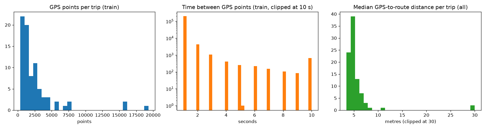

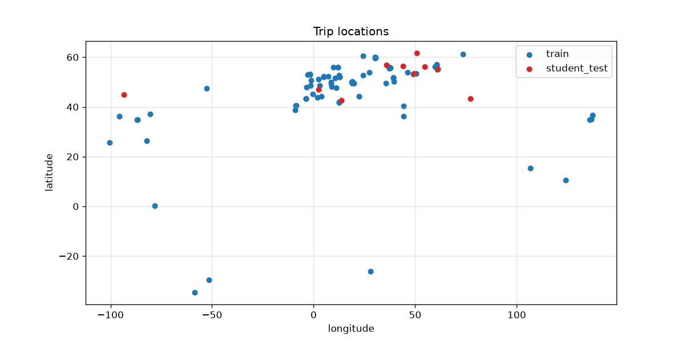

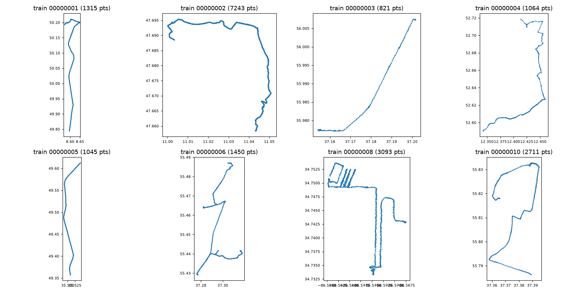

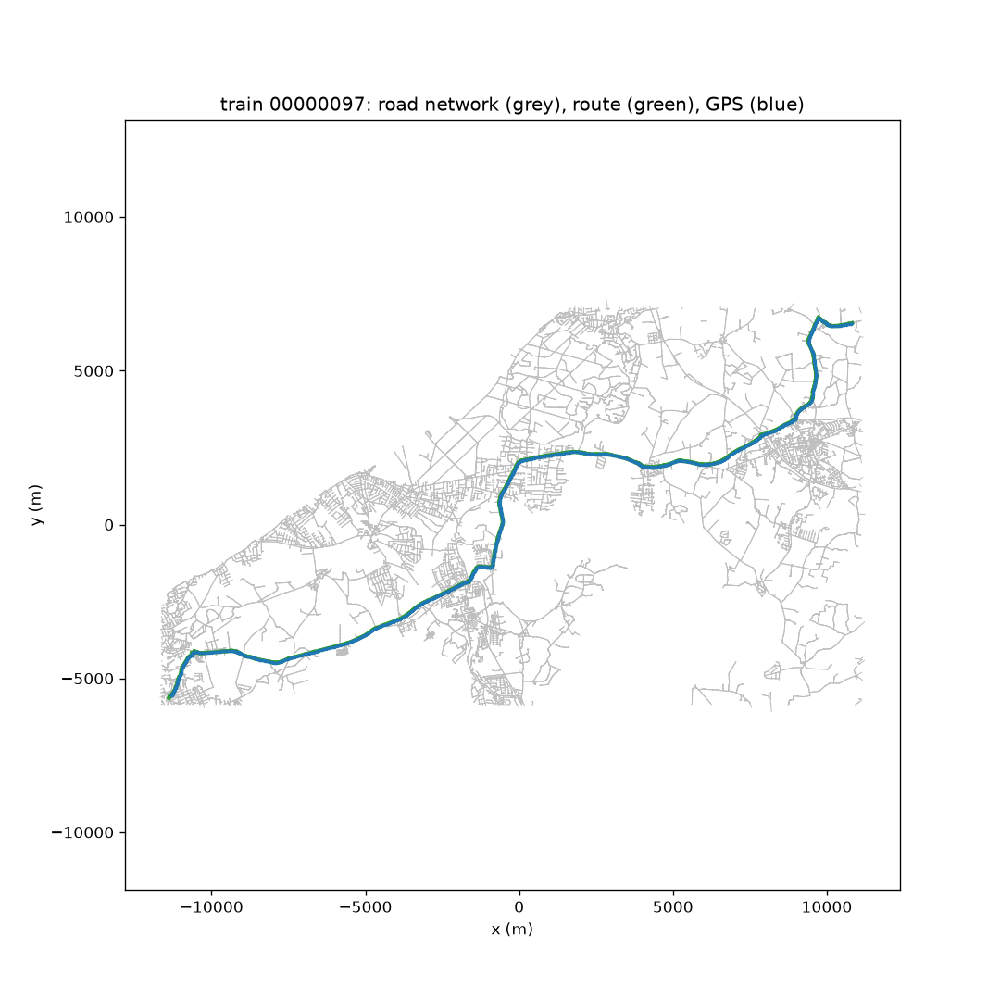

Folium map of train trip 00000097 (blue = GPS points, green = reference route, grey = road network), full view and zoomed in:

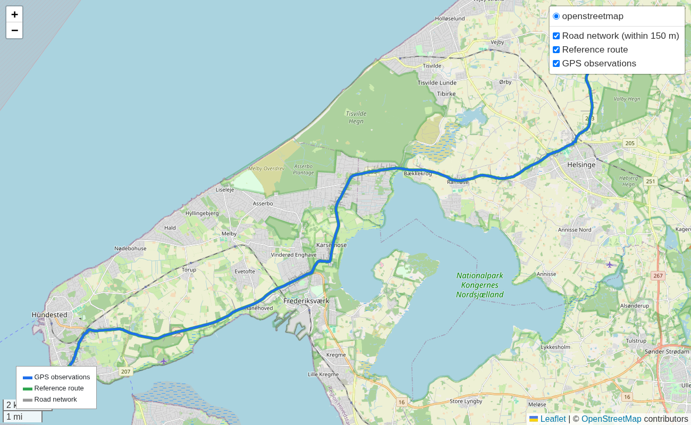

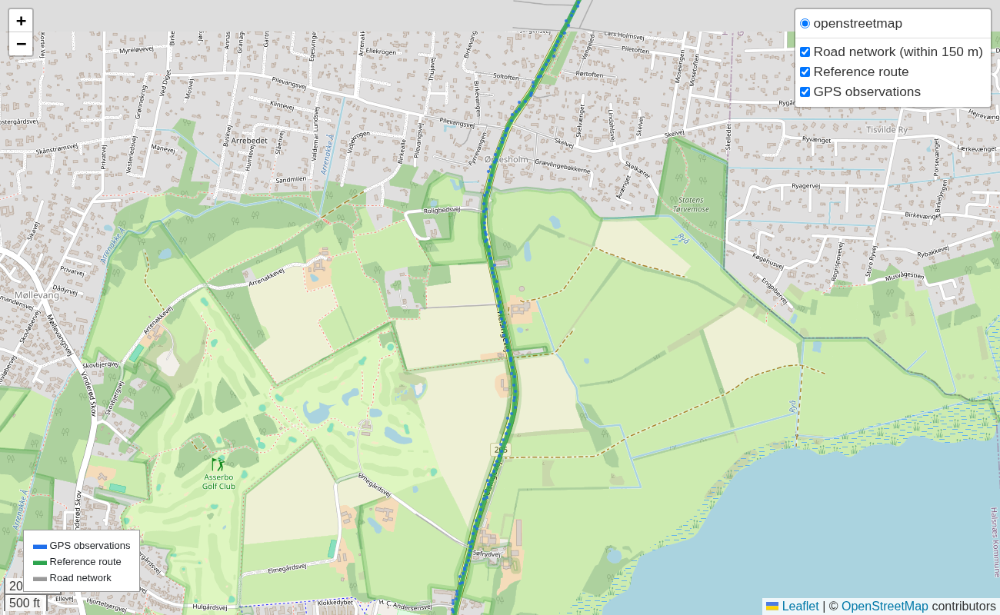

## 2.2 Preprocessing

- **Distances.** Lon/lat are angles, so we convert each trip to metres with a local equirectangular projection centred on the trip (x = R·Δlon·cos(lat0), y = R·Δlat). Trips are a few km to tens of km wide, so the error is much smaller than GPS noise. It is also much simpler than picking a UTM zone for every trip.
- **Candidates.** We put points every 10 m along every arc near the track into a KD-tree. For each GPS point we take the arcs within 50 m and keep the 8 closest. Candidate miss rate (true arc not in the candidate list) is 0.4% on student_test. On train it is 3.3%, and most of that comes from the two shifted trips.
- **Labels.** We match each GPS point to one arc of the reference route with dynamic programming: we minimise the total point-to-arc distance, and the arc index along the route is not allowed to go backwards. This gives one reference arc per GPS point. Median distance from a point to its label arc is about 4.7 m.

## 2.3 Features

Each row is one (GPS point, candidate arc) pair, with label 1 if the candidate is the reference arc. Train has 1,033,029 rows after removing the two bad trips, and student_test has 113,694 rows.

| Feature | Why |
|---|---|
| dist, dist_rank, dist_gap | how close the arc is, and how much closer the best one is |
| n_cand | how crowded the area is |
| head_diff, head_ok | the direction of travel vs the arc direction. Arcs are directed, so this is what separates the two directions of the same road |
| ctx_dist | mean distance of the 5 points before and after to this arc. One noisy point does not decide alone |
| ctx_head_diff | same idea for heading |
| speed, dt_prev | speed, and gaps that make the point unreliable |
| alen, t_proj, out_deg | arc length, where on the arc the point projects, junction size |

When the vehicle is not moving (less than 3 m in 4 s) the heading is useless. In that case we set head_diff = 90 and head_ok = 0.

# 3. Model Experimentation and Comparison

Setup, the same for every model (`pathsnap/experiment.py`):

- 5-fold GroupKFold on the 78 usable train trips. A trip is never split across folds.
- Then refit on all train trips and test once on the 10 student_test trips.
- Macro F1, precision, recall and log loss are for the binary candidate classification (threshold 0.5).
- Top-1 accuracy: for every GPS point, take the candidate with the highest score and check if it is the reference arc. Points with no candidates count as wrong.
- Route continuity: share of consecutive Top-1 picks that are the same arc or connected arcs.
- Seed 42 everywhere.

Our main metric is **Top-1 accuracy**, because that is exactly what the route needs: the right arc per GPS point. Macro F1 is used as the second metric.

## 3.1 Overall comparison

| Model | Family | Key configuration | CV Macro F1 | Top-1 Acc (test) | Route continuity (test) | Test Macro F1 | Log Loss (test) | Inference (ms / point) |
|---|---|---|---|---|---|---|---|---|
| Logistic Regression | Linear | scaled, L2, C=1 | 0.9113 | 0.8672 | 0.9169 | 0.9061 | 0.1425 | 0.0005 |
| Gaussian NB | Probabilistic | default | 0.8719 | 0.8619 | 0.9145 | 0.8578 | 0.4120 | 0.0008 |
| KNN | Instance-based | k=25, distance weighted, scaled, 150k sample | 0.9243 | 0.8705 | 0.9211 | 0.9188 | 0.1598 | 3.1782 |
| Random Forest | Bagging | 200 trees, depth 14, leaf 20 | 0.9351 | 0.8862 | 0.9322 | 0.9274 | 0.0953 | 0.0093 |
| LightGBM | Boosting | 400 rounds, lr 0.05, 31 leaves | 0.9358 | 0.8900 | 0.9396 | 0.9310 | 0.0957 | 0.0083 |
| MLP | Neural network | 64-32, Adam, early stopping | 0.9311 | 0.8862 | 0.9342 | 0.9275 | 0.0998 | 0.0060 |

Precision / recall on student_test (macro):

| Model | Precision | Recall | Train time (s) |
|---|---|---|---|
| Logistic Regression | 0.9053 | 0.9068 | 1.5 |
| Gaussian NB | 0.8299 | 0.8982 | 0.2 |
| KNN | 0.9227 | 0.9150 | 0.3 |
| Random Forest | 0.9367 | 0.9187 | 48.2 |
| LightGBM | 0.9322 | 0.9298 | 4.7 |
| MLP | 0.9297 | 0.9254 | 82.7 |

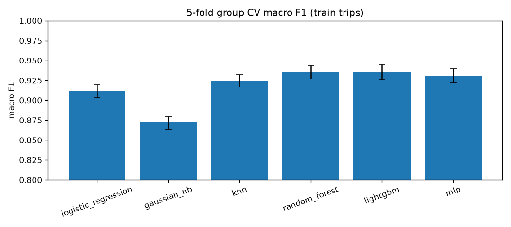

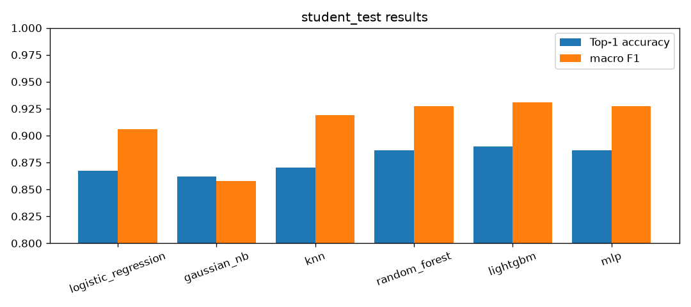

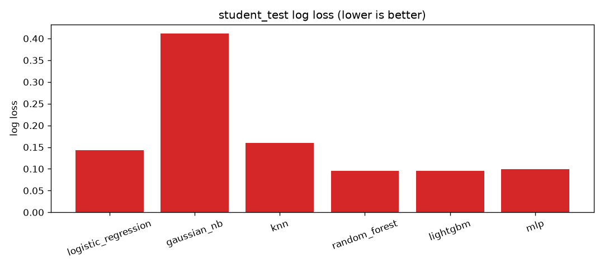

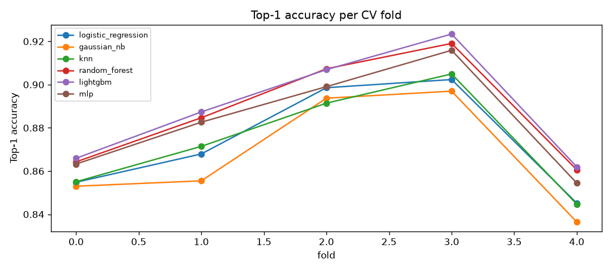

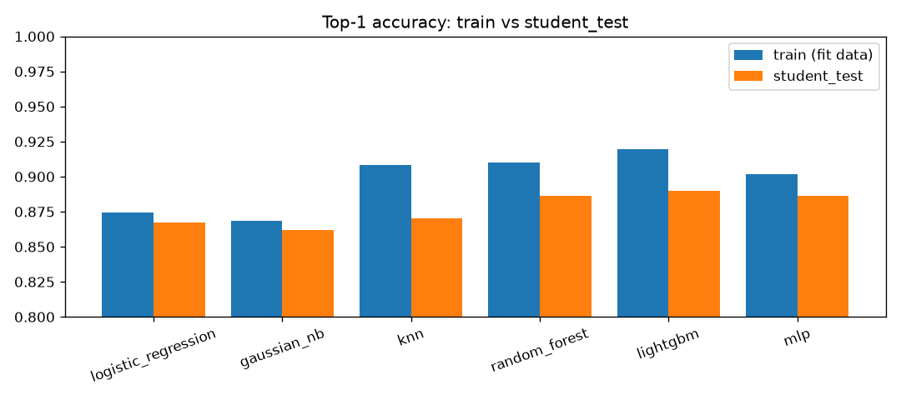

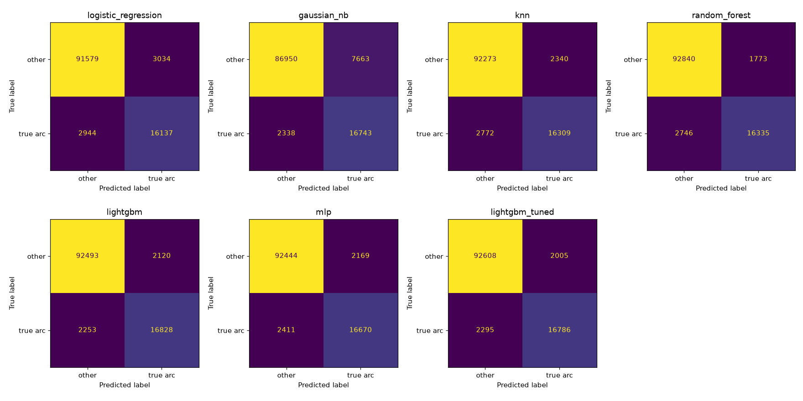

**Model choice: LightGBM.** It has the best CV macro F1, the best test Top-1 and macro F1, and the best route continuity. Its log loss is about the same as Random Forest. It trains 10x faster than RF and 18x faster than the MLP, and it gives good probabilities, which the HMM needs as emissions. The models are close (RF, MLP and LightGBM are within 0.4% Top-1), so speed and probability quality also count in its favour.

Fold 4 and fold 0 are the hardest for every model (see the per-fold plot). So the difference between trips is bigger than the difference between models.

## 3.2 Per-model answers

### Logistic Regression (Ankit)

1. Why: a simple linear baseline. Most features push in one direction (closer arc and matching heading = more likely), so a linear model should already do well.
2. Strengths: very fast, gives probabilities, easy to read. Limitations: it can't learn interactions. For example, heading matters only when the car is moving, and it can't learn that.
3. Hyperparameters: C = 1.0, L2, max_iter 1000, StandardScaler.
4. Loss: binary cross-entropy (log loss) with L2 penalty.
5. Student test: Top-1 0.8672, macro F1 0.9061, log loss 0.1425, continuity 0.9169.
6. Fit: train Top-1 0.8743 vs CV 0.8738 vs test 0.8672. All three are almost equal and lower than the tree models, so this is underfitting, not overfitting.

### Gaussian Naive Bayes (Ankit)

1. Why: a quick probabilistic baseline to compare against.
2. Strengths: trains in 0.2 s. Limitations: it assumes features are independent and Gaussian. Ours are not: dist, dist_rank, dist_gap and ctx_dist are strongly related, and the angles are not Gaussian.
3. Hyperparameters: var_smoothing 1e-9 (default).
4. Objective: maximum likelihood of class-wise Gaussians.
5. Student test: Top-1 0.8619, macro F1 0.8578, log loss 0.4120.
6. Fit: train 0.8683, test 0.8619, so it is not overfitting. The log loss of 0.41 is the worst by far. Because it double counts the related features, its probabilities are too confident. Recall (0.898) is much higher than precision (0.830).

### KNN (Aaron)

1. Why: similar (point, candidate) situations should have similar answers.
2. Strengths: no training, nonlinear. Limitations: it needs scaled features, prediction is slow, and it depends on the sample size.
3. Hyperparameters: k = 25, distance weights, StandardScaler, trained on a random 150,000-row sample (prediction on the full 1M rows was too slow).
4. Objective: none (lazy learner), majority vote weighted by 1/distance.
5. Student test: Top-1 0.8705, macro F1 0.9188, log loss 0.1598.
6. Fit: train Top-1 0.9081 vs test 0.8705, a small overfit (the distance weighting means a training point "votes for itself"). It was also the slowest at inference by a big margin: 3.18 ms per point, about 400x slower than LightGBM.

### Random Forest (Aaron)

1. Why: trees handle feature interactions (heading only matters when moving), and bagging makes them stable.
2. Strengths: strong, low log loss, little tuning. Limitations: a slow fit (48 s) and a large saved model (26 MB).
3. Hyperparameters: 200 trees, max_depth 14, min_samples_leaf 20.
4. Objective: Gini impurity at each split.
5. Student test: Top-1 0.8862, macro F1 0.9274, log loss 0.0953 (the best log loss).
6. Fit: train Top-1 0.9099 vs CV 0.8872 vs test 0.8862. There is a small gap, and depth 14 and leaf 20 keep it under control.

### LightGBM (Gaganaraj)

1. Why: gradient boosted trees usually work best on tabular features like ours, and they are fast.
2. Strengths: best results, fast, handles interactions. Limitations: more hyperparameters, and it can overfit with large trees (we saw this after tuning).
3. Hyperparameters: 400 rounds, learning rate 0.05, 31 leaves, min_child_samples 20.
4. Loss: binary log loss.
5. Student test: Top-1 0.8900, macro F1 0.9310, log loss 0.0957, continuity 0.9396.
6. Fit: train Top-1 0.9197 vs test 0.8900. The training history below shows that train log loss keeps going down, while student_test log loss flattens after about 200 rounds and does not go up. So at 400 rounds it has stopped improving but is not getting worse yet.

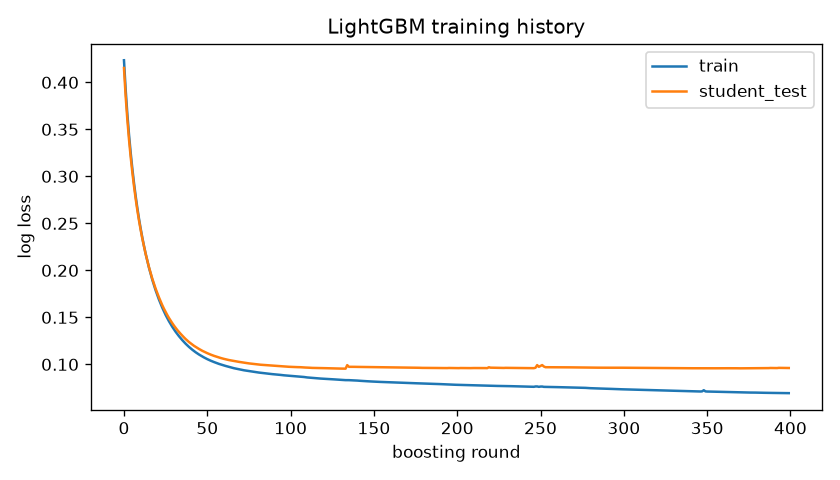

### MLP (Ananya)

1. Why: a neural network can learn nonlinear combinations of features.
2. Strengths: good results (similar to RF). Limitations: slowest to train (83 s), needs scaling, and the result depends on the random seed.
3. Hyperparameters: hidden layers 64 and 32 (ReLU), Adam, lr 0.001, batch 512, alpha 1e-4, max 60 epochs, early stopping on 10% validation, patience 8.
4. Loss: binary cross-entropy.
5. Student test: Top-1 0.8862, macro F1 0.9275, log loss 0.0998.
6. Fit: train 0.9019 vs test 0.8862, so not much overfitting. The loss curve was still going down slowly at 60 epochs (sklearn gave a convergence warning), so more epochs might help a little.

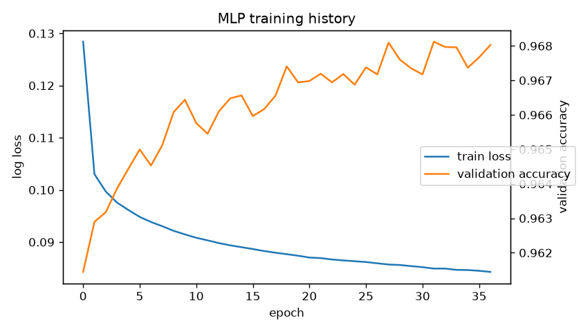

# 4. Bayesian Hyperparameter Optimisation (LightGBM)

`scripts/tune_lightgbm.py`, Optuna TPE sampler, seed 42.

1. Hyperparameters searched: n_estimators, learning_rate, num_leaves, min_child_samples, subsample, colsample_bytree, reg_lambda.
2. Ranges:

| Parameter | Range |
|---|---|
| n_estimators | 100 - 800, step 50 |
| learning_rate | 0.01 - 0.2 (log) |
| num_leaves | 15 - 255 (log) |
| min_child_samples | 5 - 200 (log) |
| subsample | 0.5 - 1.0 |
| colsample_bytree | 0.5 - 1.0 |
| reg_lambda | 0.001 - 10 (log) |

3. Objective: mean Top-1 accuracy over 3-fold GroupKFold on the train trips only. Student_test was not used in the search.
4. Trials: 30. It took 2,380 s (about 40 minutes, partly because other models were training at the same time).
5. Best values: n_estimators 650, learning_rate 0.0455, num_leaves 175, min_child_samples 6, subsample 0.887, colsample_bytree 0.837, reg_lambda 0.0239 (CV Top-1 in the search 0.8924).
6. Tuned vs untuned (same 5-fold CV and the same student_test):

| | Untuned | Tuned |
|---|---|---|
| CV Macro F1 | 0.9358 | 0.9374 |
| Test Top-1 | 0.8900 | 0.8924 |
| Test Macro F1 | 0.9310 | 0.9319 |
| Test Log Loss | 0.0957 | 0.0963 |
| Inference (ms / point) | 0.0083 | 0.0333 |
| Train Top-1 | 0.9197 | 0.9566 |

The tuned model is only a little better (+0.24% Top-1) and 4x slower at inference. Log loss got slightly worse. The train score jumped from 0.92 to 0.96, so the bigger trees overfit more. We still use the tuned model because it is better on Top-1, our main metric, and 0.03 ms per point is still fast. But tuning was not where most of the gain came from.

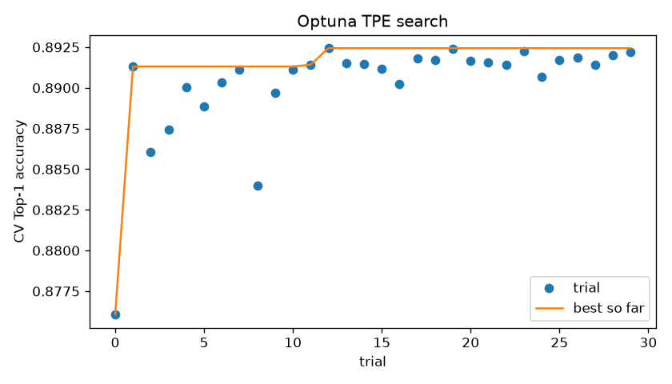

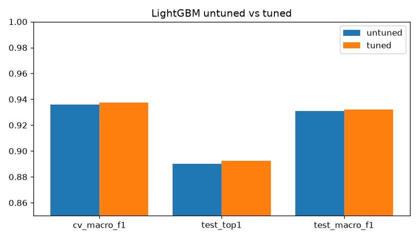

# 5. HMM and Viterbi Route Reconstruction

Code: `pathsnap/hmm.py`, experiments in `scripts/hmm_eval.py`.

1. **Hidden states:** for each GPS point, its candidate arcs (up to 8). Each state stores the arc id and the projection position on the arc, so the answer is always a real arc id.
2. **Emission:** the tuned LightGBM probability of each candidate, normalised over that point's candidates, as w_emit · log(p). For comparison we also ran a distance-only HMM with a Gaussian emission on GPS-to-arc distance (sigma).
3. **Transition:** for candidate a at point i and b at point i+1 we compute the road distance from a to b. That is the rest of arc a, plus the Dijkstra shortest path over the directed road graph, plus the part of b. Then log P = -|road distance - straight GPS distance| / beta. If b can't be reached within 2 × GPS distance + 200 m, the transition is impossible.
4. **Gaps and missing candidates:** if the time gap is over 60 s, or a point has no candidates, we end the chain and start a new one at the next point. Points with no candidates get no prediction (they count as wrong).
5. **Disconnected segments:** if no candidate of point i+1 can be reached from any candidate of point i, we also break the chain and restart from the emissions, instead of forcing a wrong connection. On student_test this happened 6 times in total (trips 0, 56 and 65).
6. **Decoder parameters:** tuned on 20 random train trips using out-of-fold classifier probabilities (no leakage). Best: beta = 1, w_emit = 4 (only w_emit × beta matters for the argmax, and 4 was best), sigma = 2 m for the distance-only HMM. Grid results are in `results/hmm_grid.csv` and `results/hmm_sigma_grid.csv`.

Results on student_test (19,160 points):

| Method | Top-1 accuracy | Route continuity | Route F1 (arc sets) |
|---|---|---|---|
| Nearest arc | 0.5353 | 0.7955 | 0.5836 |
| Classifier only (tuned LightGBM) | 0.8924 | 0.9394 | 0.8968 |
| HMM, distance-only emission | 0.9350 | 0.9749 | 0.9144 |
| Classifier + HMM (final) | 0.9266 | 0.9774 | 0.9334 |

Per trip Top-1:

| Trip | Classifier | Classifier + HMM | HMM distance-only |
|---|---|---|---|
| 00000000 | 0.956 | 0.979 | 0.962 |
| 00000007 | 0.979 | 0.999 | 0.993 |
| 00000009 | 0.885 | 0.921 | 0.863 |
| 00000040 | 0.934 | 0.947 | 0.977 |
| 00000052 | 0.985 | 0.996 | 0.981 |
| 00000056 | 0.922 | 0.962 | 0.949 |
| 00000065 | 0.862 | 0.841 | 0.840 |
| 00000076 | 0.932 | 0.977 | 0.906 |
| 00000077 | 0.741 | 0.804 | 0.899 |
| 00000091 | 0.913 | 0.957 | 0.927 |

What we see:

- The HMM helps a lot. Classifier + HMM is +3.4% Top-1 over the classifier alone, and continuity goes from 0.939 to 0.977. The classifier alone often jumps to a side road for a few points, and the HMM removes these jumps because they need a long detour on the road graph.
- Classifier + HMM is better than the distance-only HMM on 7 of 10 trips and has the best continuity and route F1. But the distance-only HMM has a higher overall Top-1 (0.935 vs 0.927). That is mostly because of trip 77 (0.899 vs 0.804) and trip 40.
- Where the HMM did not help: trip 65 got slightly worse (0.862 → 0.841). It has 3 chain breaks from gaps, and after a break the decoder restarts from the emissions only. In trip 77 the classifier is quite confident on wrong arcs in a dense city area with parallel roads. With w_emit = 4 the HMM trusts those scores too much, and the distance-only version does better there.
- We kept classifier + HMM as the final model, because it wins on more trips and gives the most connected routes. A mix of both emissions would be the next thing to try.

Example where the classifier jumps onto a side road (orange) and the HMM (red) stays on the reference route (green), trip 00000009:

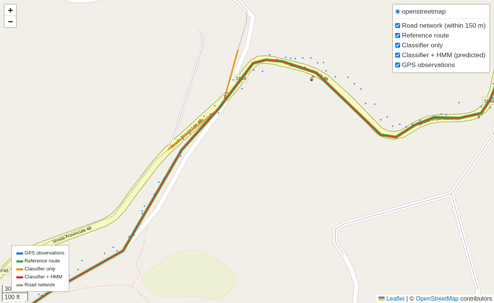

# 6. Folium Maps

Code: `scripts/make_maps.py`. The HTML maps are in `maps/`. Layers: GPS points (blue), road network within 150 m (grey), reference route (green), classifier only (orange), classifier + HMM (red), with a legend and a layer control. Note that the dataset road network does not always line up exactly with the OpenStreetMap tiles under it, because the network data is older than the current map.

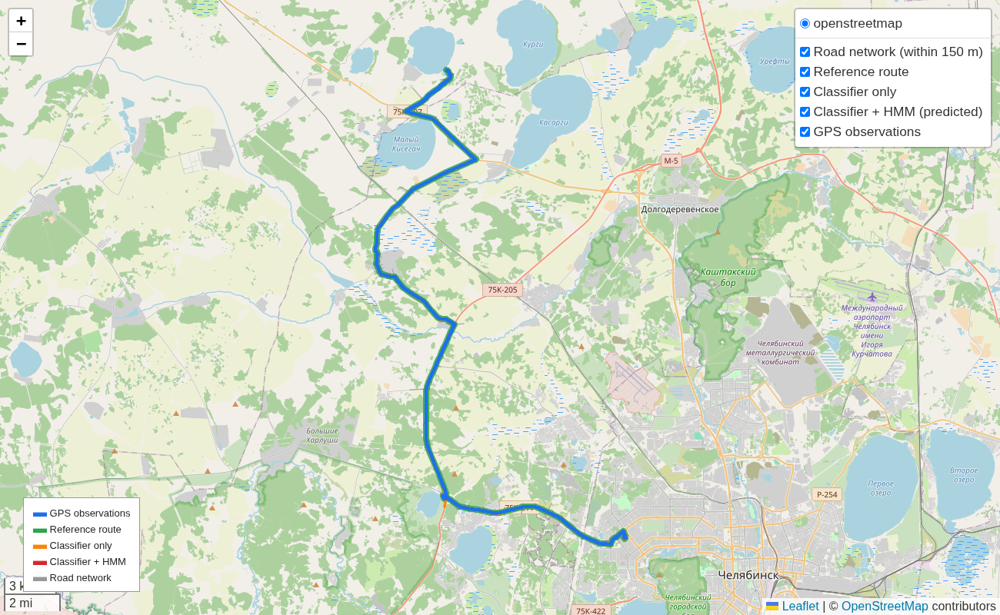

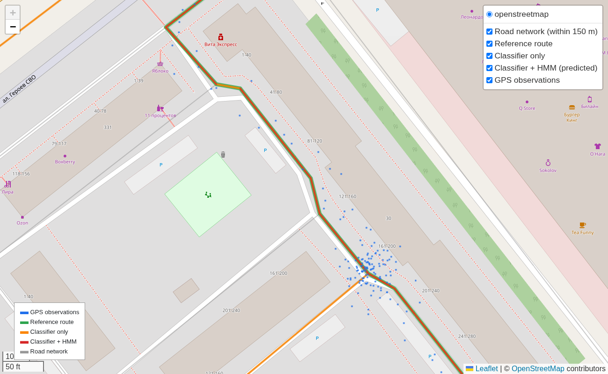

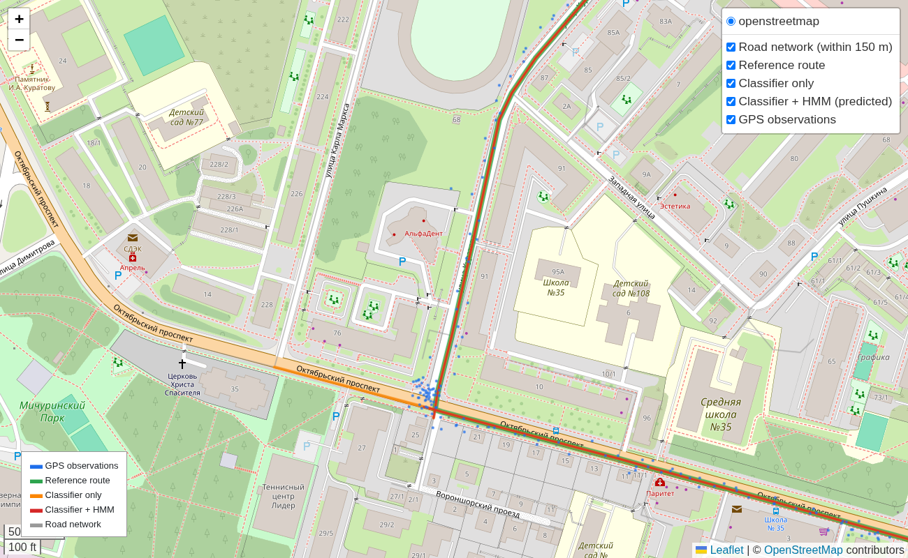

# 7. API, UI and Deployment

- Laptop 1 runs the FastAPI server (`api/app.py`). It loads `models/final_model.joblib` and `models/hmm_config.json` at startup. `POST /predict` loads only the track and the road network for the trip, runs candidates → LightGBM → Viterbi, and then scores the result against the reference route on the server. The reference route is never sent to the UI and never given to the model. Every request is printed in the terminal.
- Laptop 2 serves `ui/index.html`. It lists the trips from `GET /trips`, sends the chosen trip id to `/predict`, and draws the GPS points and predicted route with the accuracy table.
- Run instructions are in the README.

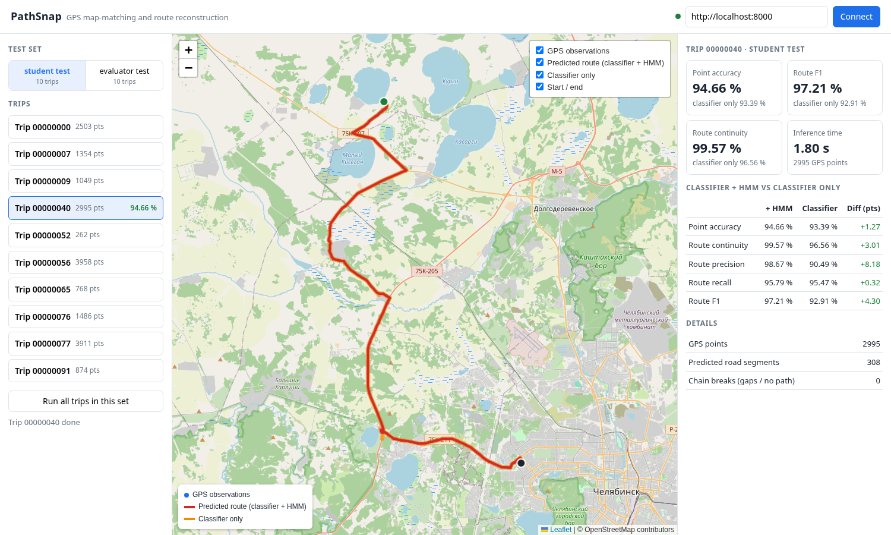

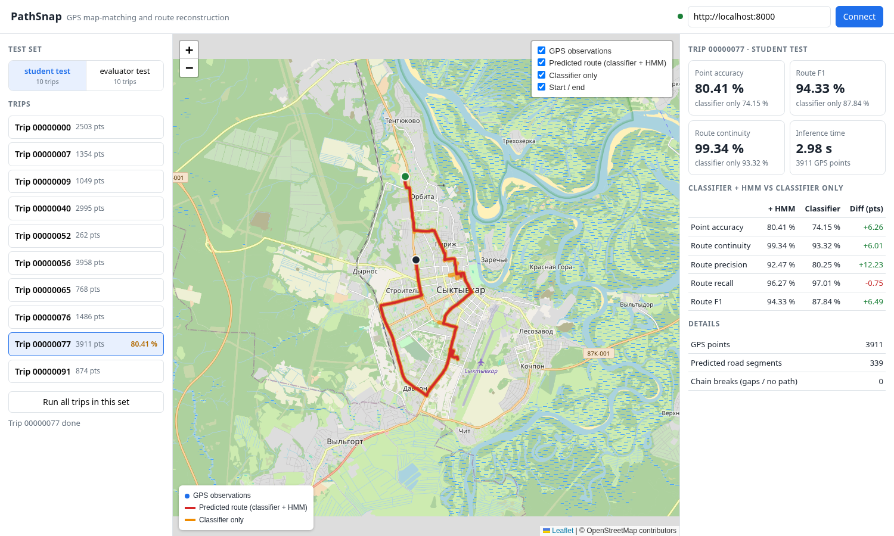

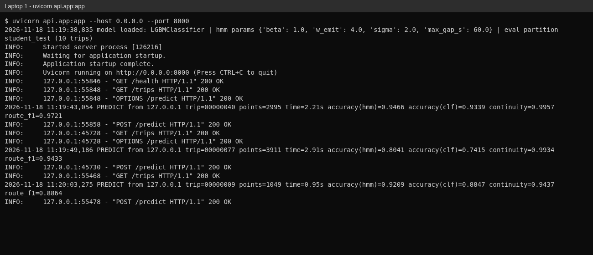

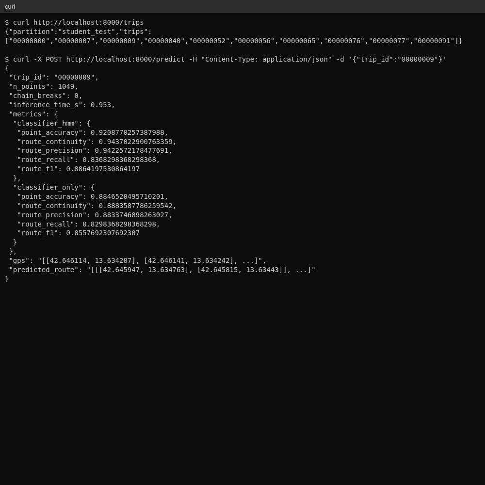

# 8. Strengths and Limitations of Our Approach

Strengths:

- The classifier looks at more than distance (heading, neighbouring points), so it handles parallel roads and the two directions of a road much better than snapping to the nearest arc (Top-1 0.892 vs 0.535).
- The HMM adds road connectivity, so the final route is almost always connected (continuity 0.977) and short wrong jumps are removed.
- Everything is checked trip-wise: CV folds never split a trip, tuning used only train trips, and the decoder was tuned on out-of-fold probabilities.
- It is fast enough for the demo: 1-3 s per trip on the API.

Limitations:

- The labels come from our own alignment of the route to the GPS points, so they can be wrong near junctions and on very short arcs.
- Two train trips were dropped because their GPS is shifted 120-140 m from the route.
- Candidates are limited to 50 m. Very noisy points have no correct candidate (0.4% on student_test).
- The decoder settings were tuned only on 20 train trips.
- On a few trips (65, 77) the HMM trusts confident but wrong classifier scores. The simpler distance-only HMM did better there.
- Tuning gave only a small gain and made the model overfit more (train Top-1 0.957 vs test 0.892).

# 9. AI use

We used an AI assistant (Claude) to help write and debug parts of the code and to format this report. All experiments were run by us on the given data, and every number above is taken from the result files in the repo.
